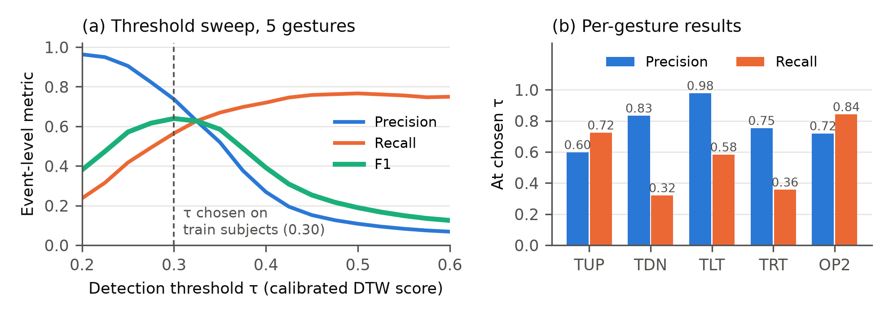

## Partial Results

We evaluated the DTW nearest-template baseline on the full IPN Hand test split: 13 subjects and
355 minutes of video, with 774 instances of the 5 held-out gestures. Each subject's demonstrations
are cut from one of their videos, and detection runs on their other three. All four videos take
turns as the demonstration source.

Our primary metric is event-level F1 (δ = 0.5 s). We also report false positives (FP) per minute,
since false triggers make a gesture interface unusable. The only tuned quantity, the threshold τ,
is chosen to maximize F1 on the 37 training subjects and then fixed for testing.

**Table 1.** DTW baseline on the test subjects. The 95% CI comes from bootstrapping subjects.

| Gestures registered | Precision | Recall | F1 [95% CI] | FP / min |
|---|---|---|---|---|
| 5 held-out (TUP, TDN, TLT, TRT, OP2) | 0.74 | 0.57 | **0.64** [0.57, 0.70] | 0.44 |

**Figure 1.** (a) Test-subject precision, recall, and F1 as the threshold varies; the dashed line
marks τ chosen on training subjects. (b) Per-gesture precision and recall at that τ.

With a single demonstration per gesture, DTW reaches an F1 of 0.64 at fewer than one false trigger
every two minutes. The τ chosen on training subjects lands at the test-set F1 peak (Fig. 1a), so
the per-template score calibration transfers across people. Detections typically fire 0.2 s before
the annotated end of a gesture.

The main weakness is recall. OP2 (0.84) and TUP (0.72) are detected reliably, but TDN and TRT are
missed about two-thirds of the time (Fig. 1b). Both gestures are well tracked by MediaPipe (98% and
90% of frames), yet even when told where the gesture is, DTW picks the correct template for only
47% of TDN and 71% of TRT instances. The errors therefore come from matching, not tracking.

Loosening τ does not help: precision collapses once τ rises above about 0.35. Performance also
varies widely across users (per-subject F1 0.64 ± 0.11, range 0.38–0.81), reflecting how noisy a
single demonstration is as a reference.

In a supplementary run, we registered all 14 gestures. The five gestures above were not hurt
(F1 0.68), but overall F1 fell to 0.41, and 71% of the false positives occurred while the user was
pointing. Clicks are performed from the pointing pose, and DTW's frame-averaged cost cannot separate
"pointing" from "pointing plus a brief finger flex". This is the case our learned encoder, with its
background margin loss, is designed to handle. Next, we will compare it against these numbers
under the same protocol.
